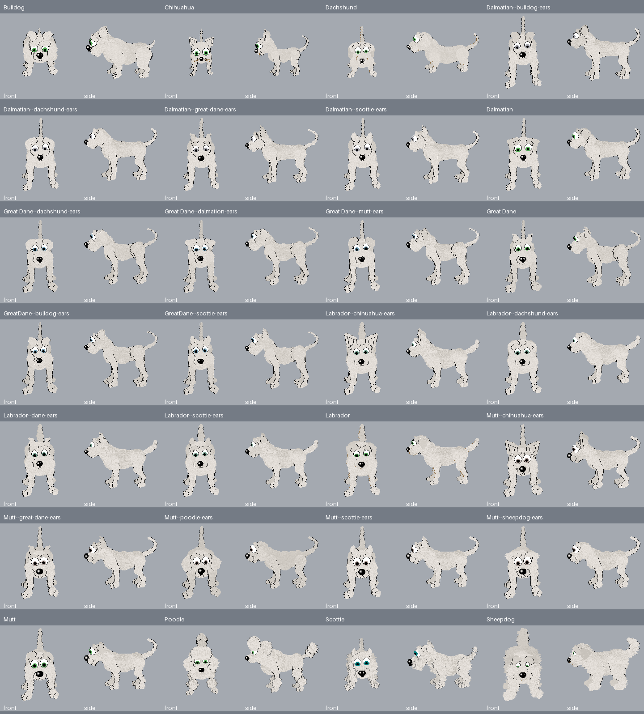

# Blank dog baseline catalog

Petz 4 reference gallery for choosing an authoring baseline. These are renderer-observed previews, not game-validated appearances.

## Start here



Open a full six-view sheet below before choosing. Overview thumbnails are individually fitted: **do not compare body size from the overview**. Full sheets align renderer projection origins in one shared canvas and use the same 2x nearest-neighbor pixel zoom, with no per-dog resizing. Gray backgrounds are presentation composites; breed colors and geometry were not edited.

The six views are standing front (yaw 0), three-quarter (45), side (90), rear (180), sitting side and lying side. Read sheets left to right, top to bottom. Controls: adult look, age 100, fatness 50, seed 41; Petz 4 stock named poses. A single seed does not cover all breed variations.

## Form cues for a first shortlist

These are qualitative observations from this catalog at its fixed controls, not breed standards or a complete anatomy validation. Confirm the exact ear variant in its full sheet.

| Family | Form cues visible in these previews |
| --- | --- |
| Bulldog | Broad head/muzzle, sturdy torso and relatively short legs |
| Chihuahua | Slender legs, rounded head and large upright ears |
| Dachshund | Long low torso, short legs and hanging ears |
| Dalmatian | Lean elongated torso and longer legs; several ear variants supplied |
| Great Dane | Leggy, angular silhouette and a long muzzle; several ear variants supplied |
| Labrador | Sturdy torso, broader muzzle and raised tail; several ear variants supplied |
| Mutt | Rounded muzzle/cheeks and curved tail; several ear variants supplied |
| Poodle | Rounded topknot, ear masses and tail pom |
| Scottie | Pointed ears, bearded muzzle and short-legged silhouette |
| Sheepdog | Shaggy outline, covered face and bushy tail |

## Blank files and stock counterparts

Names before `--` select the stock family; names after it describe the supplied ear variant. Those variant labels come from filenames and are not a verified inventory of all edits. Stock counterparts are family references, not proof of identical geometry. Rendered differences can include more than coat color.

| Editable blank (copy before editing) | Blank six views | Original stock | Stock six views |
| --- | --- | --- | --- |
| [Bulldog](petz4/Bulldog.dog) | [Blank](reference/blank-bulldog--views.png) | [Bulldog](../games/petz4/Resource/Dogz/Bulldog.dog) | [Stock](reference/stock-bulldog--views.png) |
| [Chihuahua](petz4/Chihuahua.dog) | [Blank](reference/blank-chihuahua--views.png) | [Chihuahua](../games/petz4/Resource/Dogz/Chihuahua.dog) | [Stock](reference/stock-chihuahua--views.png) |
| [Dachshund](petz4/Dachshund.dog) | [Blank](reference/blank-dachshund--views.png) | [Dachshund](../games/petz4/Resource/Dogz/Dachshund.dog) | [Stock](reference/stock-dachshund--views.png) |
| [Dalmatian--bulldog-ears](petz4/Dalmatian--bulldog-ears.dog) | [Blank](reference/blank-dalmatian-bulldog-ears--views.png) | [Dalmatian](../games/petz4/Resource/Dogz/Dalmatian.dog) | [Stock](reference/stock-dalmatian--views.png) |
| [Dalmatian--dachshund-ears](petz4/Dalmatian--dachshund-ears.dog) | [Blank](reference/blank-dalmatian-dachshund-ears--views.png) | [Dalmatian](../games/petz4/Resource/Dogz/Dalmatian.dog) | [Stock](reference/stock-dalmatian--views.png) |
| [Dalmatian--great-dane-ears](petz4/Dalmatian--great-dane-ears.dog) | [Blank](reference/blank-dalmatian-great-dane-ears--views.png) | [Dalmatian](../games/petz4/Resource/Dogz/Dalmatian.dog) | [Stock](reference/stock-dalmatian--views.png) |
| [Dalmatian--scottie-ears](petz4/Dalmatian--scottie-ears.dog) | [Blank](reference/blank-dalmatian-scottie-ears--views.png) | [Dalmatian](../games/petz4/Resource/Dogz/Dalmatian.dog) | [Stock](reference/stock-dalmatian--views.png) |
| [Dalmatian](petz4/Dalmatian.dog) | [Blank](reference/blank-dalmatian--views.png) | [Dalmatian](../games/petz4/Resource/Dogz/Dalmatian.dog) | [Stock](reference/stock-dalmatian--views.png) |
| [Great Dane--dachshund-ears](petz4/Great%20Dane--dachshund-ears.dog) | [Blank](reference/blank-great-dane-dachshund-ears--views.png) | [Great Dane](../games/petz4/Resource/Dogz/Great%20Dane.dog) | [Stock](reference/stock-great-dane--views.png) |
| [Great Dane--dalmation-ears](petz4/Great%20Dane--dalmation-ears.dog) | [Blank](reference/blank-great-dane-dalmation-ears--views.png) | [Great Dane](../games/petz4/Resource/Dogz/Great%20Dane.dog) | [Stock](reference/stock-great-dane--views.png) |
| [Great Dane--mutt-ears](petz4/Great%20Dane--mutt-ears.dog) | [Blank](reference/blank-great-dane-mutt-ears--views.png) | [Great Dane](../games/petz4/Resource/Dogz/Great%20Dane.dog) | [Stock](reference/stock-great-dane--views.png) |
| [Great Dane](petz4/Great%20Dane.dog) | [Blank](reference/blank-great-dane--views.png) | [Great Dane](../games/petz4/Resource/Dogz/Great%20Dane.dog) | [Stock](reference/stock-great-dane--views.png) |
| [GreatDane--bulldog-ears](petz4/GreatDane--bulldog-ears.dog) | [Blank](reference/blank-greatdane-bulldog-ears--views.png) | [Great Dane](../games/petz4/Resource/Dogz/Great%20Dane.dog) | [Stock](reference/stock-great-dane--views.png) |
| [GreatDane--scottie-ears](petz4/GreatDane--scottie-ears.dog) | [Blank](reference/blank-greatdane-scottie-ears--views.png) | [Great Dane](../games/petz4/Resource/Dogz/Great%20Dane.dog) | [Stock](reference/stock-great-dane--views.png) |
| [Labrador--chihuahua-ears](petz4/Labrador--chihuahua-ears.dog) | [Blank](reference/blank-labrador-chihuahua-ears--views.png) | [Labrador](../games/petz4/Resource/Dogz/Labrador.dog) | [Stock](reference/stock-labrador--views.png) |
| [Labrador--dachshund-ears](petz4/Labrador--dachshund-ears.dog) | [Blank](reference/blank-labrador-dachshund-ears--views.png) | [Labrador](../games/petz4/Resource/Dogz/Labrador.dog) | [Stock](reference/stock-labrador--views.png) |
| [Labrador--dane-ears](petz4/Labrador--dane-ears.dog) | [Blank](reference/blank-labrador-dane-ears--views.png) | [Labrador](../games/petz4/Resource/Dogz/Labrador.dog) | [Stock](reference/stock-labrador--views.png) |
| [Labrador--scottie-ears](petz4/Labrador--scottie-ears.dog) | [Blank](reference/blank-labrador-scottie-ears--views.png) | [Labrador](../games/petz4/Resource/Dogz/Labrador.dog) | [Stock](reference/stock-labrador--views.png) |
| [Labrador](petz4/Labrador.dog) | [Blank](reference/blank-labrador--views.png) | [Labrador](../games/petz4/Resource/Dogz/Labrador.dog) | [Stock](reference/stock-labrador--views.png) |
| [Mutt--chihuahua-ears](petz4/Mutt--chihuahua-ears.dog) | [Blank](reference/blank-mutt-chihuahua-ears--views.png) | [Mutt](../games/petz4/Resource/Dogz/Mutt.dog) | [Stock](reference/stock-mutt--views.png) |
| [Mutt--great-dane-ears](petz4/Mutt--great-dane-ears.dog) | [Blank](reference/blank-mutt-great-dane-ears--views.png) | [Mutt](../games/petz4/Resource/Dogz/Mutt.dog) | [Stock](reference/stock-mutt--views.png) |
| [Mutt--poodle-ears](petz4/Mutt--poodle-ears.dog) | [Blank](reference/blank-mutt-poodle-ears--views.png) | [Mutt](../games/petz4/Resource/Dogz/Mutt.dog) | [Stock](reference/stock-mutt--views.png) |
| [Mutt--scottie-ears](petz4/Mutt--scottie-ears.dog) | [Blank](reference/blank-mutt-scottie-ears--views.png) | [Mutt](../games/petz4/Resource/Dogz/Mutt.dog) | [Stock](reference/stock-mutt--views.png) |
| [Mutt--sheepdog-ears](petz4/Mutt--sheepdog-ears.dog) | [Blank](reference/blank-mutt-sheepdog-ears--views.png) | [Mutt](../games/petz4/Resource/Dogz/Mutt.dog) | [Stock](reference/stock-mutt--views.png) |
| [Mutt](petz4/Mutt.dog) | [Blank](reference/blank-mutt--views.png) | [Mutt](../games/petz4/Resource/Dogz/Mutt.dog) | [Stock](reference/stock-mutt--views.png) |
| [Poodle](petz4/Poodle.dog) | [Blank](reference/blank-poodle--views.png) | [Poodle](../games/petz4/Resource/Dogz/Poodle.dog) | [Stock](reference/stock-poodle--views.png) |
| [Scottie](petz4/Scottie.dog) | [Blank](reference/blank-scottie--views.png) | [Scottie](../games/petz4/Resource/Dogz/Scottie.dog) | [Stock](reference/stock-scottie--views.png) |
| [Sheepdog](petz4/Sheepdog.dog) | [Blank](reference/blank-sheepdog--views.png) | [Sheepdog](../games/petz4/Resource/Dogz/Sheepdog.dog) | [Stock](reference/stock-sheepdog--views.png) |

## Choose by form

Compare body length/height and leg proportions first, then head/muzzle, ear silhouette and tail. Use the stock coat to help locate overlapping parts when a white blank is hard to read; use the blank sheet to verify what is actually present in the editable file. Check sitting/lying before accepting an ear or attachment construction. A breed name alone does not establish which baseline best matches a new picture.

For the edit workflow and evidence limits, see the [authoring guide](../agent-guides/picture-to-breed.md) and [feature map](../agent-guides/feature-to-control.md).

## Reproduce and transfer

Generated by local stdio MCP from renderer checkout `49c7f62eab51b61b9f68801ba7571178670c433e`. Installed source hashes, dependency versions, capabilities, pose hashes, per-render arguments/metadata, input/output hashes and integrity results are in [the private manifest](reference/manifest.json). Inputs are read-only throughout rendering.

Re-run from `/workspace` with the matching environment:

```sh
scratch/petz-local-venv/bin/python tools/render_clean_dogs.py
```

The script resumes only matching input/runtime checkpoints and verifies cached PNG hashes. It rebuilds sheets/index from those frames. To produce a fresh catalog with changed inputs or runtime, archive the existing `clean_dogs/reference/` folder first.

Breed files and `reference/` are intentionally ignored by Git. **Transfer the entire `clean_dogs/` folder, including images, to the authoring agent** along with the documentation. Stock-file links require the matching `games/petz4/` folder; stock preview sheets remain usable without that folder. Private metadata can contain local paths. No proprietary assets or renders are included in documentation commits.
