# Texture selection catalog

238 local BMP candidates with matching PNG previews. This is the supplied collection, **not a complete inventory of Petz textures**. Original sources, game versions and resource availability were not supplied. Babyz, utility and test artwork are mixed with pet materials.

Start with the [agent workflow](README.md). Dimensions and preview RGB are [file-verified](audit.json); categories, descriptions, tags and suggested uses are editorial search hints. Stock-breed assignments, tint colors, transparency and native behavior are unvalidated.

The previews show each BMP's embedded RGB palette, at forced square thumbnail size here. Open the individual PNG at native aspect ratio before choosing. These are opaque bitmap previews, not renders on a pet; bright magenta is not proof of an alpha channel. Existing contact-sheet labels predate the review: notably `Bunny.bmp` is an illustration and `BLACK.bmp` is banded. The corrected tables below take precedence.

## Contact sheets

- [Fur and animal patterns](sheet_1_fur_and_animals.png)
- [Clothing and fabrics](sheet_2_clothing_and_fabrics.png)
- [Costumes and decoration](sheet_3_costumes_and_decor.png)
- [Surfaces and environment](sheet_4_surfaces_and_environment.png)
- [Babyz and utility](sheet_5_babyz_and_utility.png)

Contact sheets and source artwork stay local and are excluded from Git. Metadata remains usable without them; auditing and visual selection require the supplied assets.

## Pet Fur & Coats (9 textures)

| Preview | Texture Filename | Subcategory | Dimensions | Visual Look | Suggested Use (unvalidated) |
| :---: | :--- | :--- | :---: | :--- | :--- |
|  | **`HAIR11.bmp`** | Curly / Wavy Fur | `64x64` | Dense wavy/curly hair texture with tight curls and soft volume. | Poodle curls (Fifi), Dachshund wavy ears/tail, curly coats, sheep wool. |
| 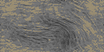 | **`HAIR20.bmp`** | Short / Fine Coat | `128x64` | Very short, fine hair grain with subtle detailing. | Chihuahua (ChiChi), short-haired puppies/kittens, bellies, inner ears. |
| 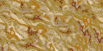 | **`HAIR3.bmp`** | Wiry / Wavy Fur | `128x64` | Fine, slightly wiry or wavy coat texture with distinct hair strands. | Terriers (Scottie, Jack Russell), wiry coats, beard/whisker tufts, ruffled tails. |
|  | **`HAIR4.bmp`** | Sleek / Smooth Fur | `64x32` | Smooth, sleek coat with soft directional sheen and fine texture. | Short-haired cats (Siamese, Russian Blue), sleek dogs, muzzle fur, paws. |
|  | **`HAIR6.bmp`** | Scruffy / Shaggy Fur | `128x128` | Tousled, scruffy fur texture with prominent clumps and rough edges. | Mutt/Scamp scruff, German Shepherd ruff, ChiChi coat, fluffy tail tufts, chest fur. |
| 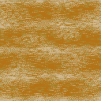 | **`SCOTT1.bmp`** | Coarse Terrier Coat | `128x128` | Coarse, bristly terrier coat texture with horizontal/vertical grain. | Scottish Terrier body and leg furnishings, rough-coated breeds, eyebrows and beards. |
| 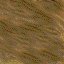 | **`TEDDY1.bmp`** | Teddy Bear Fur | `64x64` | Fuzzy, curly mohair teddy bear fur texture. | Plush toys, teddy bear breeds, woolly pet coats, cuddly accessories. |
| 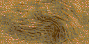 | **`hair10.bmp`** | Standard Fur | `128x64` | Medium fluffy coat with soft natural clumping. The standard universal fur texture for Petz. | Primary body coat for most dogs and cats (Persian, Labrador, Sheepdog, Great Dane); ears, tails, cheek fluff. |
| 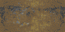 | **`plush.bmp`** | Velvety Plush Coat | `128x64` | Soft, dense velvety plush texture reminiscent of stuffed toys and soft undercoats. | Vanilla Dalmatian, Pouncer shorthair, Brownie, stuffed toy petz, velvet muzzles. |

---

## Animal Markings & Patterns (30 textures)

| Preview | Texture Filename | Subcategory | Dimensions | Visual Look | Suggested Use (unvalidated) |
| :---: | :--- | :--- | :---: | :--- | :--- |
|  | **`BEE2.bmp`** | Bumblebee Stripes | `32x32` | Vibrant yellow and black horizontal bee stripes. | Bee costume accessories, insect petz, warning stripes on toyz. |
|  | **`BLACKSTRIPE.bmp`** | Stripes & Bands | `64x64` | Linear striping texture (BLACKSTRIPE) for coat striping or clothing accents. | Tabby stripes, tail rings, leg banding, racing stripes, collar patterns. |
| 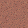 | **`BUNNYBROWN.bmp`** | Bunny Rabbit Fur | `32x32` | Soft, dense rabbit pelt texture (BUNNYBROWN) in natural rabbit coloration. | Rabbit petz, long bunny ears, fluffy cottontails, soft puppy coats. |
|  | **`BUNNYBROWN2.bmp`** | Bunny Rabbit Fur | `32x32` | Soft, dense rabbit pelt texture (BUNNYBROWN2) in natural rabbit coloration. | Rabbit petz, long bunny ears, fluffy cottontails, soft puppy coats. |
|  | **`BUNNYGREY.bmp`** | Bunny Rabbit Fur | `32x32` | Soft, dense rabbit pelt texture (BUNNYGREY) in natural rabbit coloration. | Rabbit petz, long bunny ears, fluffy cottontails, soft puppy coats. |
| 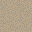 | **`BUNNYTAN.bmp`** | Bunny Rabbit Fur | `32x32` | Soft, dense rabbit pelt texture (BUNNYTAN) in natural rabbit coloration. | Rabbit petz, long bunny ears, fluffy cottontails, soft puppy coats. |
| 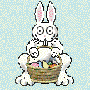 | **`Bunny.bmp`** | Rabbit illustration motif | `128x128` | Illustrated white rabbit on a pale patterned background; not a rabbit fur tile. | Rabbit-themed decorative surfaces; inspect the illustration at the intended scale. |
| 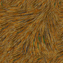 | **`CALI2.bmp`** | Calico Cat Patches | `128x128` | Classic calico cat patchwork fur pattern (CALI2) with irregular organic blotches. | Calico cat breed, tortoiseshell coats, piebald markings, multi-toned patches. |
| 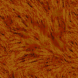 | **`CALI5.bmp`** | Calico Cat Patches | `128x128` | Classic calico cat patchwork fur pattern (CALI5) with irregular organic blotches. | Calico cat breed, tortoiseshell coats, piebald markings, multi-toned patches. |
|  | **`COW.bmp`** | Cow Spots | `64x64` | Classic black and white Holstein cow blotches and patches. | Cow customs, Dalmatian spot alternatives, pinto horse markings, dairy cow toys. |
|  | **`GIRAFFE.bmp`** | Giraffe Polygonal Coat | `64x64` | Warm brown and tan polygonal patchwork pattern of a giraffe. | Giraffe customs, reptilian scales, turtle shells, mosaic textures. |
| 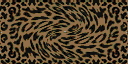 | **`LEOPARD.bmp`** | Leopard Rosettes | `128x64` | Iconic golden leopard coat pattern with black and brown rosettes. | Leopard, cheetah, exotic spotted cats (Bengal), safari-themed breeds and toys. |
| 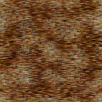 | **`LYNX04.bmp`** | Lynx / Bobcat Spots | `128x128` | Lynx/wildcat pelt pattern with small rosettes, spots, and subtle striping. | Lynx, bobcat, serval, spotted tabby cats, wildcat customs. |
| 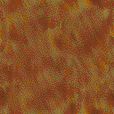 | **`MAINE4.bmp`** | Tabby / Maine Coon Stripes | `128x128` | Maine Coon cat classic tabby striping (MAINE4) with bold natural coat bars. | Tabby cats, Maine Coon bodies/legs, wildcats, tiger markings. |
| 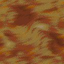 | **`MAINE5.bmp`** | Tabby / Maine Coon Stripes | `128x128` | Maine Coon cat classic tabby striping (MAINE5) with bold natural coat bars. | Tabby cats, Maine Coon bodies/legs, wildcats, tiger markings. |
| 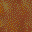 | **`MAINE9.bmp`** | Tabby / Maine Coon Stripes | `32x32` | Maine Coon cat classic tabby striping (MAINE9) with bold natural coat bars. | Tabby cats, Maine Coon bodies/legs, wildcats, tiger markings. |
| 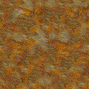 | **`MOTTLED2.bmp`** | Mottled / Scruffy Patches | `128x128` | Mottled, speckled fur marking (MOTTLED2) with irregular soft-edged spots. | Mutt (Scamp, Scaredy), flecked dog coats, roan coats, ticking markings on hounds/pointers. |
| 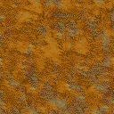 | **`MOTTLED5.bmp`** | Mottled / Scruffy Patches | `128x128` | Mottled, speckled fur marking (MOTTLED5) with irregular soft-edged spots. | Mutt (Scamp, Scaredy), flecked dog coats, roan coats, ticking markings on hounds/pointers. |
|  | **`Paw Print.bmp`** | Paw Prints Motif | `64x64` | Charming repeating dog/cat paw prints pattern. | Pet blankets, clothing, collar accents, themed toys, doghouse floors. |
| 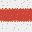 | **`REDSTRIPE.bmp`** | Stripes & Bands | `32x32` | Linear striping texture (REDSTRIPE) for coat striping or clothing accents. | Tabby stripes, tail rings, leg banding, racing stripes, collar patterns. |
|  | **`STRIPES.bmp`** | Stripes & Bands | `64x32` | Linear striping texture (STRIPES) for coat striping or clothing accents. | Tabby stripes, tail rings, leg banding, racing stripes, collar patterns. |
| 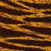 | **`TIGER2.bmp`** | Tiger Stripes | `64x64` | Bold black tiger stripes over golden/orange fur background. | Tiger customs, bold tabby markings, fantasy stripes on tails and legs. |
|  | **`ZEBRA.bmp`** | Zebra Stripes | `64x64` | High-contrast black and white zebra striping (ZEBRA). | Zebra customs, racing stripes, high-contrast monochrome accent balls. |
|  | **`ZEBRA2.bmp`** | Zebra Stripes | `32x32` | High-contrast black and white zebra striping (ZEBRA2). | Zebra customs, racing stripes, high-contrast monochrome accent balls. |
| 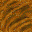 | **`stripe11.bmp`** | Stripes & Bands | `32x32` | Linear striping texture (STRIPE11) for coat striping or clothing accents. | Tabby stripes, tail rings, leg banding, racing stripes, collar patterns. |
| 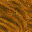 | **`stripe13.bmp`** | Stripes & Bands | `32x32` | Linear striping texture (STRIPE13) for coat striping or clothing accents. | Tabby stripes, tail rings, leg banding, racing stripes, collar patterns. |
| 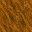 | **`stripe14.bmp`** | Stripes & Bands | `32x32` | Linear striping texture (STRIPE14) for coat striping or clothing accents. | Tabby stripes, tail rings, leg banding, racing stripes, collar patterns. |
|  | **`stripe16.bmp`** | Stripes & Bands | `32x32` | Linear striping texture (STRIPE16) for coat striping or clothing accents. | Tabby stripes, tail rings, leg banding, racing stripes, collar patterns. |
|  | **`stripe17.bmp`** | Stripes & Bands | `32x32` | Linear striping texture (STRIPE17) for coat striping or clothing accents. | Tabby stripes, tail rings, leg banding, racing stripes, collar patterns. |
| 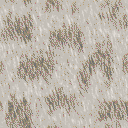 | **`stripe3.bmp`** | Stripes & Bands | `128x128` | Linear striping texture (STRIPE3) for coat striping or clothing accents. | Tabby stripes, tail rings, leg banding, racing stripes, collar patterns. |

---

## Facial Features & Anatomy (4 textures)

| Preview | Texture Filename | Subcategory | Dimensions | Visual Look | Suggested Use (unvalidated) |
| :---: | :--- | :--- | :---: | :--- | :--- |
| 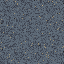 | **`JOWL1.bmp`** | Wrinkled Jowls & Muzzles | `64x64` | Wrinkled skin and fold texture (JOWL1) designed specifically for pet faces. | Bulldog and Boxer jowls, Great Dane muzzles, Shar-Pei wrinkles, cheek folds. |
| 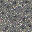 | **`JOWL2.bmp`** | Wrinkled Jowls & Muzzles | `32x32` | Wrinkled skin and fold texture (JOWL2) designed specifically for pet faces. | Bulldog and Boxer jowls, Great Dane muzzles, Shar-Pei wrinkles, cheek folds. |
| 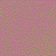 | **`SKIN1.bmp`** | Skin / Flesh Tone | `64x64` | Smooth neutral flesh/skin tone with subtle shading. | Hairless pets (Sphynx cat), babyz skin, paw pads, inner ear skin. |
|  | **`test_iris_texture.bmp`** | Eye Iris Texture | `64x64` | Detailed circular eye iris with radial fibers and pupil shading. | Custom pet eyes, realistic eye balls, magical glowing eyes, custom iris colors. |

---

## Clothing, Fabrics & Sweaters (41 textures)

| Preview | Texture Filename | Subcategory | Dimensions | Visual Look | Suggested Use (unvalidated) |
| :---: | :--- | :--- | :---: | :--- | :--- |
|  | **`BLUERIB.bmp`** | Ribbed Knit Fabric | `64x64` | Vertical ribbed knit texture (BLUERIB) for collars, cuffs, and trims. | Sweater collars and cuffs, pet socks, winter caps, striped accents. |
|  | **`BLUESOCKS.bmp`** | Blue Sock Knit | `32x32` | Blue knitted sock texture with heel/cuff detailing. | Paw booties, socks, leg warmers, winter gear. |
|  | **`CLOTHRED.bmp`** | Woven Cloth | `64x64` | Vibrant woven cloth fabric (CLOTHRED). | Bandanas, capes, ribbons, bows, costume clothing. |
|  | **`CLOTHYELLOW.bmp`** | Woven Cloth | `64x64` | Vibrant woven cloth fabric (CLOTHYELLOW). | Bandanas, capes, ribbons, bows, costume clothing. |
| 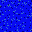 | **`COTTONBLUE.bmp`** | Solid Cotton Weave | `32x32` | Smooth woven cotton cloth in blue tone (COTTONBLUE). | T-shirts, pet bandanas, collars, dresses, cloth linings, simple clothing. |
|  | **`COTTONBLUE2.bmp`** | Solid Cotton Weave | `32x32` | Smooth woven cotton cloth in blue2 tone (COTTONBLUE2). | T-shirts, pet bandanas, collars, dresses, cloth linings, simple clothing. |
|  | **`COTTONBLUE3.bmp`** | Solid Cotton Weave | `32x32` | Smooth woven cotton cloth in blue3 tone (COTTONBLUE3). | T-shirts, pet bandanas, collars, dresses, cloth linings, simple clothing. |
|  | **`COTTONBLUE4.bmp`** | Solid Cotton Weave | `32x32` | Smooth woven cotton cloth in blue4 tone (COTTONBLUE4). | T-shirts, pet bandanas, collars, dresses, cloth linings, simple clothing. |
|  | **`COTTONGREEN.bmp`** | Solid Cotton Weave | `32x32` | Smooth woven cotton cloth in green tone (COTTONGREEN). | T-shirts, pet bandanas, collars, dresses, cloth linings, simple clothing. |
|  | **`COTTONGREEN2.bmp`** | Solid Cotton Weave | `32x32` | Smooth woven cotton cloth in green2 tone (COTTONGREEN2). | T-shirts, pet bandanas, collars, dresses, cloth linings, simple clothing. |
|  | **`COTTONGREEN3.bmp`** | Solid Cotton Weave | `32x32` | Smooth woven cotton cloth in green3 tone (COTTONGREEN3). | T-shirts, pet bandanas, collars, dresses, cloth linings, simple clothing. |
|  | **`COTTONGREY.bmp`** | Solid Cotton Weave | `32x32` | Smooth woven cotton cloth in grey tone (COTTONGREY). | T-shirts, pet bandanas, collars, dresses, cloth linings, simple clothing. |
|  | **`COTTONORANGE.bmp`** | Solid Cotton Weave | `32x32` | Smooth woven cotton cloth in orange tone (COTTONORANGE). | T-shirts, pet bandanas, collars, dresses, cloth linings, simple clothing. |
|  | **`COTTONORANGE2.bmp`** | Solid Cotton Weave | `32x32` | Smooth woven cotton cloth in orange2 tone (COTTONORANGE2). | T-shirts, pet bandanas, collars, dresses, cloth linings, simple clothing. |
|  | **`COTTONPINK.bmp`** | Solid Cotton Weave | `32x32` | Smooth woven cotton cloth in pink tone (COTTONPINK). | T-shirts, pet bandanas, collars, dresses, cloth linings, simple clothing. |
|  | **`COTTONPURP.bmp`** | Solid Cotton Weave | `32x32` | Smooth woven cotton cloth in purp tone (COTTONPURP). | T-shirts, pet bandanas, collars, dresses, cloth linings, simple clothing. |
|  | **`COTTONPURP02.bmp`** | Solid Cotton Weave | `32x32` | Smooth woven cotton cloth in purp02 tone (COTTONPURP02). | T-shirts, pet bandanas, collars, dresses, cloth linings, simple clothing. |
|  | **`COTTONRED.bmp`** | Solid Cotton Weave | `32x32` | Smooth woven cotton cloth in red tone (COTTONRED). | T-shirts, pet bandanas, collars, dresses, cloth linings, simple clothing. |
|  | **`COTTONWHITE.bmp`** | Solid Cotton Weave | `32x32` | Smooth woven cotton cloth in white tone (COTTONWHITE). | T-shirts, pet bandanas, collars, dresses, cloth linings, simple clothing. |
| 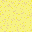 | **`COTTONYELLOW.bmp`** | Solid Cotton Weave | `32x32` | Smooth woven cotton cloth in yellow tone (COTTONYELLOW). | T-shirts, pet bandanas, collars, dresses, cloth linings, simple clothing. |
| 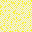 | **`COTTONYELLOW2.bmp`** | Solid Cotton Weave | `32x32` | Smooth woven cotton cloth in yellow2 tone (COTTONYELLOW2). | T-shirts, pet bandanas, collars, dresses, cloth linings, simple clothing. |
| 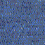 | **`DENIM.bmp`** | Denim / Jeans | `64x64` | Woven denim twill weave (DENIM) in classic blue jean style. | Pet overalls, denim jackets, rugged clothing, pocket details. |
| 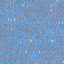 | **`DENIMWASHED.bmp`** | Denim / Jeans | `64x64` | Woven denim twill weave (DENIMWASHED) in classic blue jean style. | Pet overalls, denim jackets, rugged clothing, pocket details. |
| 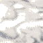 | **`DIAPER0.bmp`** | Diapers | `64x64` | Baby diaper texture (DIAPER0) with elastic waistband and adhesive tabs. | Babyz diaper models, puppy training pads, comedy pet costumes. |
|  | **`DIAPER1.bmp`** | Diapers | `64x64` | Baby diaper texture (DIAPER1) with elastic waistband and adhesive tabs. | Babyz diaper models, puppy training pads, comedy pet costumes. |
| 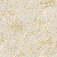 | **`DIAPER2.bmp`** | Diapers | `64x64` | Baby diaper texture (DIAPER2) with elastic waistband and adhesive tabs. | Babyz diaper models, puppy training pads, comedy pet costumes. |
|  | **`LONGJOHN.bmp`** | Thermal Longjohns | `32x32` | Thermal waffle-knit longjohn underwear texture. | Winter thermal suits, cozy pajamas, textured pet sweaters. |
|  | **`PJBALLOON.bmp`** | Pajama Prints | `32x32` | Charming pajama fabric print (PJBALLOON) with cheerful nursery motifs. | Pet pajamas, babyz onesies, cozy blankets, puppy nursery bedding. |
|  | **`PJBALLOON2.bmp`** | Pajama Prints | `32x32` | Charming pajama fabric print (PJBALLOON2) with cheerful nursery motifs. | Pet pajamas, babyz onesies, cozy blankets, puppy nursery bedding. |
|  | **`PJBASE.bmp`** | Pajama Prints | `32x32` | Charming pajama fabric print (PJBASE) with cheerful nursery motifs. | Pet pajamas, babyz onesies, cozy blankets, puppy nursery bedding. |
|  | **`PJBOAT.bmp`** | Pajama Prints | `32x32` | Charming pajama fabric print (PJBOAT) with cheerful nursery motifs. | Pet pajamas, babyz onesies, cozy blankets, puppy nursery bedding. |
|  | **`PJDUCK.bmp`** | Pajama Prints | `32x32` | Charming pajama fabric print (PJDUCK) with cheerful nursery motifs. | Pet pajamas, babyz onesies, cozy blankets, puppy nursery bedding. |
|  | **`QUILTBLUE.bmp`** | Quilted Stitched Fabric | `46x46` | Blue diamond-stitched quilted fabric with padded puffy texture. | Padded pet coats, sleeping bags, doggy beds, winter vests. |
| 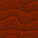 | **`REDRIB.bmp`** | Ribbed Knit Fabric | `64x64` | Vertical ribbed knit texture (REDRIB) for collars, cuffs, and trims. | Sweater collars and cuffs, pet socks, winter caps, striped accents. |
| 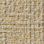 | **`SWTR3.bmp`** | Knit Sweaters | `64x64` | Cozy cable-knit sweater texture (SWTR3) with woven wool ribbing. | Dog/cat sweaters (Bulldog/Fifi winter outfits), knit scarves, winter hats, blankets. |
|  | **`SWTR7.bmp`** | Knit Sweaters | `64x64` | Cozy cable-knit sweater texture (SWTR7) with woven wool ribbing. | Dog/cat sweaters (Bulldog/Fifi winter outfits), knit scarves, winter hats, blankets. |
|  | **`TANRIB.bmp`** | Ribbed Knit Fabric | `32x32` | Vertical ribbed knit texture (TANRIB) for collars, cuffs, and trims. | Sweater collars and cuffs, pet socks, winter caps, striped accents. |
|  | **`TERRYBLUE.bmp`** | Terrycloth / Towel | `64x32` | Looped terrycloth fabric (TERRYBLUE) resembling bath towels and robes. | Pet bathrobes, cozy pet beds, towel accessories, plush toys. |
| 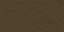 | **`TERRYBROWN.bmp`** | Terrycloth / Towel | `64x32` | Looped terrycloth fabric (TERRYBROWN) resembling bath towels and robes. | Pet bathrobes, cozy pet beds, towel accessories, plush toys. |
| 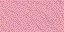 | **`TERRYPINK.bmp`** | Terrycloth / Towel | `64x32` | Looped terrycloth fabric (TERRYPINK) resembling bath towels and robes. | Pet bathrobes, cozy pet beds, towel accessories, plush toys. |
|  | **`YELLOWRIB.bmp`** | Ribbed Knit Fabric | `64x64` | Vertical ribbed knit texture (YELLOWRIB) for collars, cuffs, and trims. | Sweater collars and cuffs, pet socks, winter caps, striped accents. |

---

## Plaids, Checkers & Polka Dots (15 textures)

| Preview | Texture Filename | Subcategory | Dimensions | Visual Look | Suggested Use (unvalidated) |
| :---: | :--- | :--- | :---: | :--- | :--- |
|  | **`Blue Plaid.bmp`** | Plaid & Tartan | `128x128` | Classic crisscross plaid/tartan woven fabric pattern (BLUE PLAID). | Scottish Terrier coats, flannel shirts, cozy blankets, winter pet coats. |
|  | **`CHECKER.bmp`** | Checkered Patterns | `16x16` | Geometric checkerboard / gingham pattern (CHECKER). | Picnic blankets, racing flag accents, retro bandanas, checkered collars. |
| 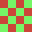 | **`CHECKER2.bmp`** | Checkered Patterns | `32x32` | Geometric checkerboard / gingham pattern (CHECKER2). | Picnic blankets, racing flag accents, retro bandanas, checkered collars. |
| 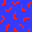 | **`CHECKS.bmp`** | Checkered Patterns | `32x32` | Geometric checkerboard / gingham pattern (CHECKS). | Picnic blankets, racing flag accents, retro bandanas, checkered collars. |
| 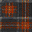 | **`PLAID.bmp`** | Plaid & Tartan | `32x32` | Classic crisscross plaid/tartan woven fabric pattern (PLAID). | Scottish Terrier coats, flannel shirts, cozy blankets, winter pet coats. |
|  | **`PLAID5.bmp`** | Plaid & Tartan | `32x32` | Classic crisscross plaid/tartan woven fabric pattern (PLAID5). | Scottish Terrier coats, flannel shirts, cozy blankets, winter pet coats. |
|  | **`PLAIDBLUE.bmp`** | Plaid & Tartan | `32x32` | Classic crisscross plaid/tartan woven fabric pattern (PLAIDBLUE). | Scottish Terrier coats, flannel shirts, cozy blankets, winter pet coats. |
| 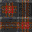 | **`PLAIDRED.bmp`** | Plaid & Tartan | `32x32` | Classic crisscross plaid/tartan woven fabric pattern (PLAIDRED). | Scottish Terrier coats, flannel shirts, cozy blankets, winter pet coats. |
|  | **`POLKA.bmp`** | Polka Dots | `32x32` | Playful polka dot pattern (POLKA) with repeating circular spots. | Clown outfits, party hats, retro dresses, cheerful pet bandanas and bows. |
|  | **`POLKABG.bmp`** | Polka Dots | `32x32` | Playful polka dot pattern (POLKABG) with repeating circular spots. | Clown outfits, party hats, retro dresses, cheerful pet bandanas and bows. |
|  | **`POLKABLUE.bmp`** | Polka Dots | `32x32` | Playful polka dot pattern (POLKABLUE) with repeating circular spots. | Clown outfits, party hats, retro dresses, cheerful pet bandanas and bows. |
| 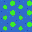 | **`POLKACLOWN.bmp`** | Polka Dots | `32x32` | Playful polka dot pattern (POLKACLOWN) with repeating circular spots. | Clown outfits, party hats, retro dresses, cheerful pet bandanas and bows. |
|  | **`POLKARED.bmp`** | Polka Dots | `32x32` | Playful polka dot pattern (POLKARED) with repeating circular spots. | Clown outfits, party hats, retro dresses, cheerful pet bandanas and bows. |
| 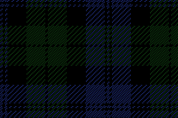 | **`Tartan.bmp`** | Plaid & Tartan | `300x200` | Classic crisscross plaid/tartan woven fabric pattern (TARTAN). | Scottish Terrier coats, flannel shirts, cozy blankets, winter pet coats. |
| 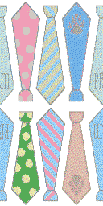 | **`Tie.bmp`** | Necktie Stripes | `128x256` | Diagonal striped silk necktie pattern. | Business collar ties, formal pet attire, gentleman dog outfits. |

---

## Costumes, Armor & Fantasy (20 textures)

| Preview | Texture Filename | Subcategory | Dimensions | Visual Look | Suggested Use (unvalidated) |
| :---: | :--- | :--- | :---: | :--- | :--- |
| 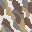 | **`CAMOD.bmp`** | Camouflage | `32x32` | Military camouflage pattern (CAMOD) in earthy outdoor tones. | Hunting dog vests, military gear, outdoor camping accessories. |
| 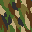 | **`CAMOJ.bmp`** | Camouflage | `32x32` | Military camouflage pattern (CAMOJ) in earthy outdoor tones. | Hunting dog vests, military gear, outdoor camping accessories. |
| 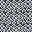 | **`CHAINMAIL1.bmp`** | Chainmail Armor | `32x32` | Interlocking metallic steel chainmail rings (CHAINMAIL1). | Knight armor, medieval pet customs, dragon scales, metal accessories. |
| 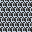 | **`CHAINMAIL2.bmp`** | Chainmail Armor | `32x32` | Interlocking metallic steel chainmail rings (CHAINMAIL2). | Knight armor, medieval pet customs, dragon scales, metal accessories. |
| 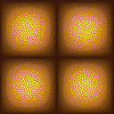 | **`Disco.bmp`** | Disco / Glitter | `128x128` | Sparkling reflective disco tile grid with glittering highlights. | Disco collars, party petz, glowing futuristic accents, mirror balls. |
|  | **`GOLF.bmp`** | Golf Attire | `32x32` | Classic preppy golf print / argyle fabric (GOLF). | Golf caps, preppy pet vests, country club customs. |
|  | **`GOLF2.bmp`** | Golf Attire | `32x32` | Classic preppy golf print / argyle fabric (GOLF2). | Golf caps, preppy pet vests, country club customs. |
|  | **`GOLF3.bmp`** | Golf Attire | `32x32` | Classic preppy golf print / argyle fabric (GOLF3). | Golf caps, preppy pet vests, country club customs. |
|  | **`GOLFHAT.bmp`** | Golf Attire | `32x32` | Classic preppy golf print / argyle fabric (GOLFHAT). | Golf caps, preppy pet vests, country club customs. |
|  | **`HAWAIIAN.bmp`** | Hawaiian Floral Shirt | `32x32` | Bright tropical Hawaiian aloha shirt print (HAWAIIAN) with flowers. | Summer shirts, beach vacation petz, tropical party leis and bandanas. |
|  | **`HAWAIIAN2.bmp`** | Hawaiian Floral Shirt | `32x32` | Bright tropical Hawaiian aloha shirt print (HAWAIIAN2) with flowers. | Summer shirts, beach vacation petz, tropical party leis and bandanas. |
|  | **`HELMET.bmp`** | Metallic Armor Plate | `32x32` | Polished metallic steel plate surface (HELMET). | Knight helmets, robotic pet parts, metallic collars, sci-fi armor. |
|  | **`HELMET2.bmp`** | Metallic Armor Plate | `32x32` | Polished metallic steel plate surface (HELMET2). | Knight helmets, robotic pet parts, metallic collars, sci-fi armor. |
|  | **`RIDDLER.bmp`** | Question Marks Pattern | `32x32` | Vibrant green fabric patterned with bold question marks. | Comic book villain costumes, mystery-themed petz, quirky toys. |
|  | **`SKI2.bmp`** | Retro Ski Wear | `32x32` | Vibrant retro 80s/90s ski jacket geometric pattern. | Snow coats, winter sports gear, retro athletic pet outfits. |
|  | **`TIEDYE.bmp`** | Tie-Dye Swirls | `64x64` | Vibrant swirl tie-dye pattern (TIEDYE) with vivid blending colors. | Hippie customs, colorful party shirts, psychedelic pet fur, custom toys. |
|  | **`TIEDYE2.bmp`** | Tie-Dye Swirls | `64x64` | Vibrant swirl tie-dye pattern (TIEDYE2) with vivid blending colors. | Hippie customs, colorful party shirts, psychedelic pet fur, custom toys. |
|  | **`TIEDYE4.bmp`** | Tie-Dye Swirls | `32x32` | Vibrant swirl tie-dye pattern (TIEDYE4) with vivid blending colors. | Hippie customs, colorful party shirts, psychedelic pet fur, custom toys. |
|  | **`Tiki.bmp`** | Polynesian Tiki | `128x128` | Carved wooden Polynesian tiki totem pattern. | Island customs, tropical masks, exotic decor, wooden toys. |
|  | **`WIZARD.bmp`** | Wizard Robe | `32x32` | Midnight blue mystical fabric adorned with golden moons and stars. | Wizard hats, magic cloaks, fantasy petz, celestial accessories. |

---

## Surfaces & Environment (27 textures)

| Preview | Texture Filename | Subcategory | Dimensions | Visual Look | Suggested Use (unvalidated) |
| :---: | :--- | :--- | :---: | :--- | :--- |
|  | **`Beach.bmp`** | Sand & Shoreline | `256x256` | Natural sand / shoreline texture (BEACH). | Beach playscenes, desert tortoise shells, sandy pet markings. |
|  | **`Blue Carpet.bmp`** | Room Carpets & Shag Rugs | `128x128` | Dense woven room carpet / thick shag pile (BLUE CARPET). | Ultra-fluffy pet coats, plush pet beds, playscene floors. |
|  | **`Blue Tile.bmp`** | Ceramic & Linoleum Tiles | `64x64` | Glossy ceramic or linoleum architectural tiles (BLUE TILE). | Kitchen/bathroom playscenes, mosaic sculptures, reptile scales. |
|  | **`Bricks.bmp`** | Masonry & Stone | `128x64` | Rough natural masonry / stone surface (BRICKS). | Rock golem petz, garden walls, walkways, hard turtle shells. |
|  | **`Carpet.bmp`** | Room Carpets & Shag Rugs | `64x64` | Dense woven room carpet / thick shag pile (CARPET). | Ultra-fluffy pet coats, plush pet beds, playscene floors. |
|  | **`Clouds.bmp`** | Fluffy Sky Clouds | `128x128` | Soft puffy white cumulus clouds drifting across a blue sky. | Celestial winged petz, dreamscape playscene spheres, ethereal customs. |
|  | **`Cobblestone.bmp`** | Masonry & Stone | `128x128` | Rough natural masonry / stone surface (COBBLESTONE). | Rock golem petz, garden walls, walkways, hard turtle shells. |
|  | **`Desert.bmp`** | Sand & Shoreline | `128x128` | Natural sand / shoreline texture (DESERT). | Beach playscenes, desert tortoise shells, sandy pet markings. |
|  | **`Field.bmp`** | Lawn & Grassy Ground | `128x128` | Lush green outdoor grass blades texture (FIELD). | Playpen ground surfaces, grassy terrain addballz, camouflage petz. |
|  | **`Granite.bmp`** | Masonry & Stone | `128x128` | Rough natural masonry / stone surface (GRANITE). | Rock golem petz, garden walls, walkways, hard turtle shells. |
|  | **`Grass.bmp`** | Lawn & Grassy Ground | `128x128` | Lush green outdoor grass blades texture (GRASS). | Playpen ground surfaces, grassy terrain addballz, camouflage petz. |
|  | **`Hay.bmp`** | Golden Straw & Hay | `128x128` | Loose golden straw and farm hay bedding texture. | Barnyard playscenes, nest bedding, scarecrow pet customs. |
|  | **`Hextile.bmp`** | Ceramic & Linoleum Tiles | `128x128` | Glossy ceramic or linoleum architectural tiles (HEXTILE). | Kitchen/bathroom playscenes, mosaic sculptures, reptile scales. |
|  | **`Jade Floor.bmp`** | Polished Jade Stone | `128x128` | Polished deep green luxury jade marble stone slab. | Precious stone statues, emerald dragons, palace floors. |
|  | **`Kitchen Tile.bmp`** | Ceramic & Linoleum Tiles | `128x128` | Glossy ceramic or linoleum architectural tiles (KITCHEN TILE). | Kitchen/bathroom playscenes, mosaic sculptures, reptile scales. |
|  | **`Leaves.bmp`** | Autumn Foliage | `128x128` | Scattered colorful autumn deciduous leaves. | Autumn themed petz, woodland creatures, festive fall accessories. |
|  | **`Linoleum Tile.bmp`** | Ceramic & Linoleum Tiles | `64x64` | Glossy ceramic or linoleum architectural tiles (LINOLEUM TILE). | Kitchen/bathroom playscenes, mosaic sculptures, reptile scales. |
|  | **`Purple Shag.bmp`** | Room Carpets & Shag Rugs | `128x128` | Dense woven room carpet / thick shag pile (PURPLE SHAG). | Ultra-fluffy pet coats, plush pet beds, playscene floors. |
|  | **`Red Tile.bmp`** | Ceramic & Linoleum Tiles | `32x32` | Glossy ceramic or linoleum architectural tiles (RED TILE). | Kitchen/bathroom playscenes, mosaic sculptures, reptile scales. |
|  | **`Redwood Floor.bmp`** | Hardwood Planks | `128x64` | Finished hardwood timber plank flooring (REDWOOD FLOOR). | Wooden toy custom petz, playscene floors, doghouse walls. |
|  | **`Sand.bmp`** | Sand & Shoreline | `64x64` | Natural sand / shoreline texture (SAND). | Beach playscenes, desert tortoise shells, sandy pet markings. |
|  | **`Shag Carpet.bmp`** | Room Carpets & Shag Rugs | `128x128` | Dense woven room carpet / thick shag pile (SHAG CARPET). | Ultra-fluffy pet coats, plush pet beds, playscene floors. |
|  | **`Stained Glass.bmp`** | Stained Glass Window | `128x128` | Ornate multicolored stained glass cathedral window with leaded came lines. | Magical butterfly wings, kaleidoscope petz, sacred window scenes. |
|  | **`Stone.bmp`** | Masonry & Stone | `128x128` | Rough natural masonry / stone surface (STONE). | Rock golem petz, garden walls, walkways, hard turtle shells. |
|  | **`Tile.bmp`** | Ceramic & Linoleum Tiles | `128x128` | Glossy ceramic or linoleum architectural tiles (TILE). | Kitchen/bathroom playscenes, mosaic sculptures, reptile scales. |
|  | **`Tilewave.bmp`** | Ceramic & Linoleum Tiles | `128x128` | Glossy ceramic or linoleum architectural tiles (TILEWAVE). | Kitchen/bathroom playscenes, mosaic sculptures, reptile scales. |
|  | **`Wooden Floor.bmp`** | Hardwood Planks | `128x128` | Finished hardwood timber plank flooring (WOODEN FLOOR). | Wooden toy custom petz, playscene floors, doghouse walls. |

---

## Decorative, Seasonal & Novelty (51 textures)

| Preview | Texture Filename | Subcategory | Dimensions | Visual Look | Suggested Use (unvalidated) |
| :---: | :--- | :--- | :---: | :--- | :--- |
|  | **`AMEOBA.bmp`** | Abstract & Artistic | `32x32` | Funky abstract artistic motif (AMEOBA). | Unique fantasy pet creations, custom ball markings, abstract art balls. |
|  | **`Autumn.bmp`** | Floral & Botanical | `128x128` | Delicate floral garden pattern (AUTUMN). | Spring dresses, flower crowns, garden pet accessories, floral collars. |
|  | **`BIGWAVE.bmp`** | Abstract & Artistic | `32x32` | Funky abstract artistic motif (BIGWAVE). | Unique fantasy pet creations, custom ball markings, abstract art balls. |
|  | **`BUBBLESB.bmp`** | Blue bubble outlines | `64x64` | Overlapping blue circular outlines on a pale background. | Bubble-pattern decoration; translucency is unvalidated. |
|  | **`BUBBLESP.bmp`** | Pink bubble outlines | `64x64` | Overlapping pink circular outlines on a pale background. | Bubble-pattern decoration; translucency is unvalidated. |
|  | **`Blue Dogz.bmp`** | Petz Silhouettes Pattern | `128x128` | Repeating icon silhouettes of classic BLUE DOGZ. | Petz branded wallpaper, collector shirts, pet shelter blankets. |
|  | **`CIRCLES.bmp`** | Abstract & Artistic | `32x32` | Funky abstract artistic motif (CIRCLES). | Unique fantasy pet creations, custom ball markings, abstract art balls. |
|  | **`Cupid.bmp`** | Valentine Hearts & Love | `256x256` | Sweet romantic hearts and Valentine motif (CUPID). | Valentine's Day custom petz, heart-patterned flank markings, gift collars. |
|  | **`Eggs.bmp`** | Holiday & Celebrations | `128x128` | Festive holiday seasonal pattern (EGGS). | Christmas sweaters, Easter bunny customs, Thanksgiving festive petz. |
|  | **`FLOWER.bmp`** | Floral & Botanical | `64x64` | Delicate floral garden pattern (FLOWER). | Spring dresses, flower crowns, garden pet accessories, floral collars. |
|  | **`Fireworks.bmp`** | Stars & Fireworks | `256x256` | Festive starry sky or celebratory fireworks explosion (FIREWORKS). | 4th of July customs, celebratory party petz, cosmic fantasy coats. |
|  | **`Fish.bmp`** | Aquatic Fish Pattern | `128x128` | Playful swimming tropical fish pattern. | Cat toys, aquarium playscenes, ocean-themed accessories. |
|  | **`Flowers.bmp`** | Floral & Botanical | `128x128` | Delicate floral garden pattern (FLOWERS). | Spring dresses, flower crowns, garden pet accessories, floral collars. |
|  | **`GROOVY.bmp`** | Abstract & Artistic | `64x64` | Funky abstract artistic motif (GROOVY). | Unique fantasy pet creations, custom ball markings, abstract art balls. |
|  | **`GROOVY2.bmp`** | Abstract & Artistic | `64x64` | Funky abstract artistic motif (GROOVY2). | Unique fantasy pet creations, custom ball markings, abstract art balls. |
|  | **`Green Dogz.bmp`** | Petz Silhouettes Pattern | `128x128` | Repeating icon silhouettes of classic GREEN DOGZ. | Petz branded wallpaper, collector shirts, pet shelter blankets. |
|  | **`HEARTS.bmp`** | Valentine Hearts & Love | `32x32` | Sweet romantic hearts and Valentine motif (HEARTS). | Valentine's Day custom petz, heart-patterned flank markings, gift collars. |
|  | **`HEARTS2.bmp`** | Valentine Hearts & Love | `32x32` | Sweet romantic hearts and Valentine motif (HEARTS2). | Valentine's Day custom petz, heart-patterned flank markings, gift collars. |
|  | **`HEARTS3.bmp`** | Valentine Hearts & Love | `32x32` | Sweet romantic hearts and Valentine motif (HEARTS3). | Valentine's Day custom petz, heart-patterned flank markings, gift collars. |
|  | **`HONEY1.bmp`** | Abstract & Artistic | `128x128` | Funky abstract artistic motif (HONEY1). | Unique fantasy pet creations, custom ball markings, abstract art balls. |
|  | **`Holiday1.bmp`** | Holiday & Celebrations | `128x128` | Festive holiday seasonal pattern (HOLIDAY1). | Christmas sweaters, Easter bunny customs, Thanksgiving festive petz. |
|  | **`Holiday2.bmp`** | Holiday & Celebrations | `128x128` | Festive holiday seasonal pattern (HOLIDAY2). | Christmas sweaters, Easter bunny customs, Thanksgiving festive petz. |
|  | **`Holiday3.bmp`** | Holiday & Celebrations | `256x256` | Festive holiday seasonal pattern (HOLIDAY3). | Christmas sweaters, Easter bunny customs, Thanksgiving festive petz. |
|  | **`Holiday4.bmp`** | Holiday & Celebrations | `128x128` | Festive holiday seasonal pattern (HOLIDAY4). | Christmas sweaters, Easter bunny customs, Thanksgiving festive petz. |
|  | **`Holiday5.bmp`** | Holiday & Celebrations | `128x128` | Festive holiday seasonal pattern (HOLIDAY5). | Christmas sweaters, Easter bunny customs, Thanksgiving festive petz. |
|  | **`Holiday6.bmp`** | Holiday & Celebrations | `128x128` | Festive holiday seasonal pattern (HOLIDAY6). | Christmas sweaters, Easter bunny customs, Thanksgiving festive petz. |
|  | **`I Love You.bmp`** | Valentine Hearts & Love | `128x128` | Sweet romantic hearts and Valentine motif (I LOVE YOU). | Valentine's Day custom petz, heart-patterned flank markings, gift collars. |
|  | **`Logo.bmp`** | Petz Studio / PF Magic Logo | `170x170` | Official retro Petz / P.F. Magic brand insignia logo. | Official Petz branded toys, intro screen props, studio awards. |
|  | **`Musical Notes.bmp`** | Music Notes & Sheet | `128x128` | Musical notation staff and dancing notes. | Musical pet customs (Opera/Soprano), choir collars, instrument toys. |
|  | **`Newspaper.bmp`** | Printed Newsprint | `70x157` | Vintage printed newspaper columns and headlines. | Puppy training newspapers, papier-mâché petz, vintage newsboy hats. |
|  | **`Orange Catz.bmp`** | Petz Silhouettes Pattern | `128x128` | Repeating icon silhouettes of classic ORANGE CATZ. | Petz branded wallpaper, collector shirts, pet shelter blankets. |
|  | **`PAINTED.bmp`** | Abstract & Artistic | `32x32` | Funky abstract artistic motif (PAINTED). | Unique fantasy pet creations, custom ball markings, abstract art balls. |
|  | **`PICTURE.bmp`** | Miscellaneous | `100x70` | Texture pattern PICTURE.bmp (100x70 px). | Decorative balls, paintballs, or custom accessories. |
|  | **`PICTURE2.bmp`** | Miscellaneous | `100x70` | Texture pattern PICTURE2.bmp (100x70 px). | Decorative balls, paintballs, or custom accessories. |
|  | **`PICTURE3.bmp`** | Miscellaneous | `100x70` | Texture pattern PICTURE3.bmp (100x70 px). | Decorative balls, paintballs, or custom accessories. |
|  | **`PINKIE.bmp`** | Abstract & Artistic | `18x18` | Funky abstract artistic motif (PINKIE). | Unique fantasy pet creations, custom ball markings, abstract art balls. |
|  | **`Redhot.bmp`** | Abstract & Artistic | `128x128` | Funky abstract artistic motif (REDHOT). | Unique fantasy pet creations, custom ball markings, abstract art balls. |
|  | **`Rose.bmp`** | Floral & Botanical | `128x128` | Delicate floral garden pattern (ROSE). | Spring dresses, flower crowns, garden pet accessories, floral collars. |
|  | **`SOAPBUBBLUE.bmp`** | Soap Bubbles | `16x16` | Shimmering translucent soap bubbles floating in air (SOAPBUBBLUE). | Bath time accessories, bubble wand toys, translucent magical shields. |
|  | **`SOAPBUBWHITE.bmp`** | Soap Bubbles | `16x16` | Shimmering translucent soap bubbles floating in air (SOAPBUBWHITE). | Bath time accessories, bubble wand toys, translucent magical shields. |
|  | **`SPOONWOOD.bmp`** | Abstract & Artistic | `32x32` | Funky abstract artistic motif (SPOONWOOD). | Unique fantasy pet creations, custom ball markings, abstract art balls. |
|  | **`STARS.bmp`** | Stars & Fireworks | `64x64` | Festive starry sky or celebratory fireworks explosion (STARS). | 4th of July customs, celebratory party petz, cosmic fantasy coats. |
|  | **`STARS2.bmp`** | Stars & Fireworks | `48x48` | Festive starry sky or celebratory fireworks explosion (STARS2). | 4th of July customs, celebratory party petz, cosmic fantasy coats. |
|  | **`Shamrock.bmp`** | Floral & Botanical | `128x128` | Delicate floral garden pattern (SHAMROCK). | Spring dresses, flower crowns, garden pet accessories, floral collars. |
|  | **`TRIANGLESBLUE.bmp`** | Geometric Patterns | `32x32` | Crisp repeating geometric line / polygon pattern (TRIANGLESBLUE). | Modern bandanas, geometric pet markings, argyle sweaters, collar trim. |
|  | **`TRIANGLESPINK.bmp`** | Geometric Patterns | `32x32` | Crisp repeating geometric line / polygon pattern (TRIANGLESPINK). | Modern bandanas, geometric pet markings, argyle sweaters, collar trim. |
|  | **`TRIANGLESYEL.bmp`** | Geometric Patterns | `32x32` | Crisp repeating geometric line / polygon pattern (TRIANGLESYEL). | Modern bandanas, geometric pet markings, argyle sweaters, collar trim. |
|  | **`Turkey.bmp`** | Holiday & Celebrations | `256x256` | Festive holiday seasonal pattern (TURKEY). | Christmas sweaters, Easter bunny customs, Thanksgiving festive petz. |
|  | **`WIGGLE.bmp`** | Geometric Patterns | `32x32` | Crisp repeating geometric line / polygon pattern (WIGGLE). | Modern bandanas, geometric pet markings, argyle sweaters, collar trim. |
|  | **`YELLOWDIAMOND.bmp`** | Geometric Patterns | `32x32` | Crisp repeating geometric line / polygon pattern (YELLOWDIAMOND). | Modern bandanas, geometric pet markings, argyle sweaters, collar trim. |
|  | **`ZIGZAG.bmp`** | Geometric Patterns | `32x32` | Crisp repeating geometric line / polygon pattern (ZIGZAG). | Modern bandanas, geometric pet markings, argyle sweaters, collar trim. |

---

## Babyz Hair & Templates (28 textures)

| Preview | Texture Filename | Subcategory | Dimensions | Visual Look | Suggested Use (unvalidated) |
| :---: | :--- | :--- | :---: | :--- | :--- |
|  | **`B_AFRO1.bmp`** | Babyz Afro Hair | `128x128` | Voluminous tightly curled afro hair texture (B_AFRO1). | Babyz afro hairstyles, dense woolly pet coat tufts, sheep fleece. |
|  | **`B_AFRO11.bmp`** | Babyz Afro Hair | `128x128` | Voluminous tightly curled afro hair texture (B_AFRO11). | Babyz afro hairstyles, dense woolly pet coat tufts, sheep fleece. |
|  | **`B_AFRO2.bmp`** | Babyz Afro Hair | `128x128` | Voluminous tightly curled afro hair texture (B_AFRO2). | Babyz afro hairstyles, dense woolly pet coat tufts, sheep fleece. |
|  | **`B_AFRO3.bmp`** | Babyz Afro Hair | `128x128` | Voluminous tightly curled afro hair texture (B_AFRO3). | Babyz afro hairstyles, dense woolly pet coat tufts, sheep fleece. |
|  | **`B_BLOND1.bmp`** | Babyz Blonde Hair | `64x32` | Fine blonde/golden hair strands (B_BLOND1). | Babyz blonde hair, golden retriever ear feathering, light fur tufts. |
|  | **`B_BROWNLONG1.bmp`** | Babyz Brown Hair | `128x128` | Brunette brown hair texture (B_BROWNLONG1) with realistic strand flow. | Babyz hairstyles, horse manes, long pet fur fringes. |
|  | **`B_DARKBROWN1.bmp`** | Babyz Brown Hair | `128x128` | Brunette brown hair texture (B_DARKBROWN1) with realistic strand flow. | Babyz hairstyles, horse manes, long pet fur fringes. |
|  | **`B_DARKBROWN1_TRANS.bmp`** | Babyz Brown Hair | `128x128` | Brunette brown hair texture (B_DARKBROWN1_TRANS) with realistic strand flow. | Babyz hairstyles, horse manes, long pet fur fringes. |
|  | **`B_DARKBROWN2.bmp`** | Babyz Brown Hair | `128x128` | Brunette brown hair texture (B_DARKBROWN2) with realistic strand flow. | Babyz hairstyles, horse manes, long pet fur fringes. |
|  | **`B_DARKBROWN21.bmp`** | Babyz Brown Hair | `128x128` | Brunette brown hair texture (B_DARKBROWN21) with realistic strand flow. | Babyz hairstyles, horse manes, long pet fur fringes. |
|  | **`B_DARKBROWN2_TRANS.bmp`** | Babyz Brown Hair | `128x128` | Brunette brown hair texture (B_DARKBROWN2_TRANS) with realistic strand flow. | Babyz hairstyles, horse manes, long pet fur fringes. |
|  | **`B_DARKBROWN3.bmp`** | Babyz Brown Hair | `128x128` | Brunette brown hair texture (B_DARKBROWN3) with realistic strand flow. | Babyz hairstyles, horse manes, long pet fur fringes. |
|  | **`B_DARKBROWN3_TRANS.bmp`** | Babyz Brown Hair | `128x128` | Brunette brown hair texture (B_DARKBROWN3_TRANS) with realistic strand flow. | Babyz hairstyles, horse manes, long pet fur fringes. |
|  | **`B_LTBROWN1.bmp`** | Babyz Brown Hair | `128x128` | Brunette brown hair texture (B_LTBROWN1) with realistic strand flow. | Babyz hairstyles, horse manes, long pet fur fringes. |
|  | **`B_ORANGE1.bmp`** | Babyz Red / Orange Hair | `64x64` | Bright ginger/redhead baby hair texture (B_ORANGE1). | Babyz redhead hair, Irish Setter coat accents, orange fox tails. |
|  | **`B_ORANGE2.bmp`** | Babyz Red / Orange Hair | `128x128` | Bright ginger/redhead baby hair texture (B_ORANGE2). | Babyz redhead hair, Irish Setter coat accents, orange fox tails. |
|  | **`B_TRANS1.bmp`** | Hair Fringe & Transitions | `128x128` | Hair/fringe pattern (B_TRANS1) with magenta regions in the opaque RGB preview; transparency behavior unvalidated. | Hair-fringe candidate only; validate palette-index handling on the intended host. |
|  | **`B_TRANS11.bmp`** | Hair Fringe & Transitions | `128x128` | Hair/fringe pattern (B_TRANS11) with magenta regions in the opaque RGB preview; transparency behavior unvalidated. | Hair-fringe candidate only; validate palette-index handling on the intended host. |
|  | **`B_TRANS2.bmp`** | Hair Fringe & Transitions | `128x128` | Hair/fringe pattern (B_TRANS2) with magenta regions in the opaque RGB preview; transparency behavior unvalidated. | Hair-fringe candidate only; validate palette-index handling on the intended host. |
|  | **`B_TRANS21.bmp`** | Hair Fringe & Transitions | `128x128` | Hair/fringe pattern (B_TRANS21) with magenta regions in the opaque RGB preview; transparency behavior unvalidated. | Hair-fringe candidate only; validate palette-index handling on the intended host. |
|  | **`B_TRANS3.bmp`** | Hair Fringe & Transitions | `128x128` | Hair/fringe pattern (B_TRANS3) with magenta regions in the opaque RGB preview; transparency behavior unvalidated. | Hair-fringe candidate only; validate palette-index handling on the intended host. |
|  | **`B_TRANSNEW1.bmp`** | Hair Fringe & Transitions | `128x128` | Hair/fringe pattern (B_TRANSNEW1) with magenta regions in the opaque RGB preview; transparency behavior unvalidated. | Hair-fringe candidate only; validate palette-index handling on the intended host. |
|  | **`B_TRANSNEW2.bmp`** | Hair Fringe & Transitions | `128x128` | Hair/fringe pattern (B_TRANSNEW2) with magenta regions in the opaque RGB preview; transparency behavior unvalidated. | Hair-fringe candidate only; validate palette-index handling on the intended host. |
|  | **`B_TRANSNEW3.bmp`** | Hair Fringe & Transitions | `128x128` | Hair/fringe pattern (B_TRANSNEW3) with magenta regions in the opaque RGB preview; transparency behavior unvalidated. | Hair-fringe candidate only; validate palette-index handling on the intended host. |
|  | **`B_TRANSNEW4.bmp`** | Hair Fringe & Transitions | `128x128` | Hair/fringe pattern (B_TRANSNEW4) with magenta regions in the opaque RGB preview; transparency behavior unvalidated. | Hair-fringe candidate only; validate palette-index handling on the intended host. |
|  | **`babyz_128x128_centered.bmp`** | Face Alignment Templates | `128x128` | Head/face alignment reference template (BABYZ_128X128_CENTERED). | Technical alignment marker for Babyz head and eye placement. |
|  | **`babyz_256x256_centered.bmp`** | Face Alignment Templates | `256x256` | Head/face alignment reference template (BABYZ_256X256_CENTERED). | Technical alignment marker for Babyz head and eye placement. |
|  | **`babyz_64x64_centered.bmp`** | Face Alignment Templates | `64x64` | Head/face alignment reference template (BABYZ_64X64_CENTERED). | Technical alignment marker for Babyz head and eye placement. |

---

## Solids & Utility (9 textures)

| Preview | Texture Filename | Subcategory | Dimensions | Visual Look | Suggested Use (unvalidated) |
| :---: | :--- | :--- | :---: | :--- | :--- |
|  | **`BLACK.bmp`** | Dark bands | `64x64` | Dark horizontal bands; not a uniform solid fill. | Dark banded material candidate; inspect the target-host preview. |
|  | **`BLACKNOISE.bmp`** | Grain / Dithered Noise | `32x32` | Subtle dithered noise grain (BLACKNOISE) that adds tactile matte tooth to surfaces. | Adding subtle surface roughness to smooth balls, preventing flat plastic appearance. |
|  | **`CLEAR.bmp`** | Single-index utility | `128x128` | 128x128 bitmap filled with palette index 253. The PNG is opaque magenta; game transparency is unvalidated. | Diagnostic candidate only; do not assume invisibility, collision behavior or an alpha channel. |
|  | **`PURP.bmp`** | Dark speckled grain | `128x64` | Dark field with scattered contrasting grain; not a uniform purple fill. | Subtle grain candidate; rendered color depends on mode, indices and host. |
|  | **`Pink.bmp`** | Pink speckled grain | `128x128` | Pink field with fine contrasting speckles; not a uniform solid fill. | Pink grain candidate; inspect the target-host preview. |
|  | **`Plain.bmp`** | Solid Fills | `32x32` | Solid uniform flat color fill (PLAIN). | Base color coats without texture grain, flat cartoon finishes, solid accessories. |
|  | **`YELLOWNOISE.bmp`** | Grain / Dithered Noise | `32x32` | Subtle dithered noise grain (YELLOWNOISE) that adds tactile matte tooth to surfaces. | Adding subtle surface roughness to smooth balls, preventing flat plastic appearance. |
|  | **`test_no_tex_rot_size_100x100.bmp`** | Rotation Test Benchmarks | `100x100` | Directional reference bitmap (test_no_tex_rot_size_100x100); no native-game orientation test supplied. | Debugging ball rotation and orientation in LNZ editing. |
|  | **`test_no_tex_rot_size_256x256.bmp`** | Rotation Test Benchmarks | `256x256` | Directional reference bitmap (test_no_tex_rot_size_256x256); no native-game orientation test supplied. | Debugging ball rotation and orientation in LNZ editing. |

---

## General Patterns & Textures (4 textures)

| Preview | Texture Filename | Subcategory | Dimensions | Visual Look | Suggested Use (unvalidated) |
| :---: | :--- | :--- | :---: | :--- | :--- |
|  | **`EGYPTM03.bmp`** | Miscellaneous | `128x128` | Texture pattern EGYPTM03.bmp (128x128 px). | Decorative balls, paintballs, or custom accessories. |
|  | **`HERRING.bmp`** | Miscellaneous | `32x32` | Texture pattern HERRING.bmp (32x32 px). | Decorative balls, paintballs, or custom accessories. |
|  | **`HERRING2.bmp`** | Miscellaneous | `32x32` | Texture pattern HERRING2.bmp (32x32 px). | Decorative balls, paintballs, or custom accessories. |
|  | **`SCRIBBLE.bmp`** | Miscellaneous | `32x32` | Texture pattern SCRIBBLE.bmp (32x32 px). | Decorative balls, paintballs, or custom accessories. |

The five supplied contact sheets cover 234 entries. `EGYPTM03.bmp`, `HERRING.bmp`, `HERRING2.bmp` and `SCRIBBLE.bmp` are absent from those sheets; use their individual previews in the [General Patterns table](INDEX.md#general-patterns--textures-4-textures).
